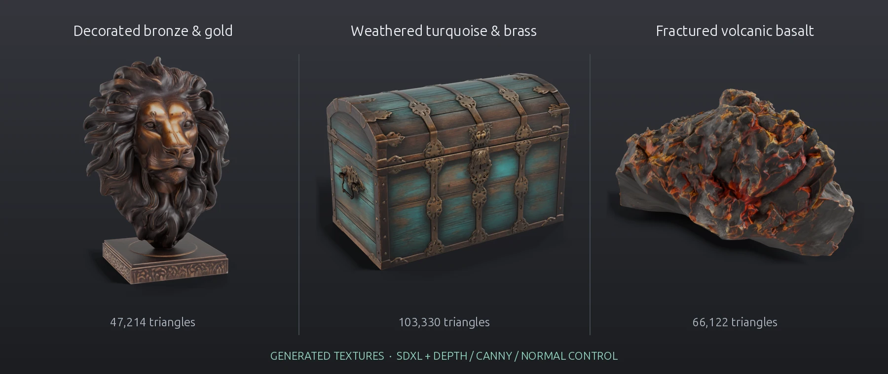
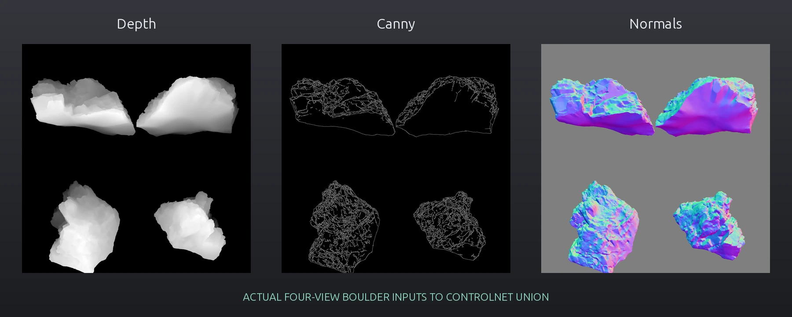
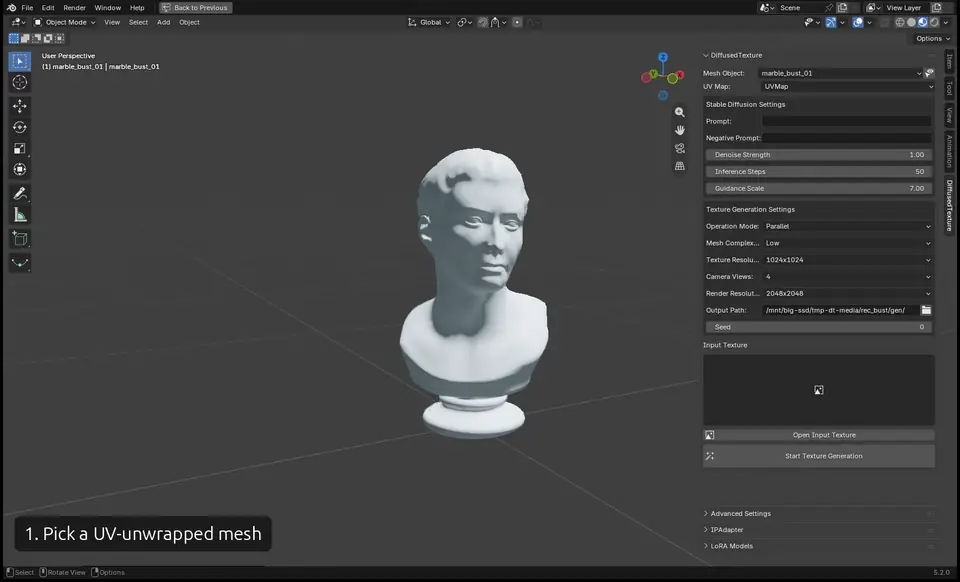
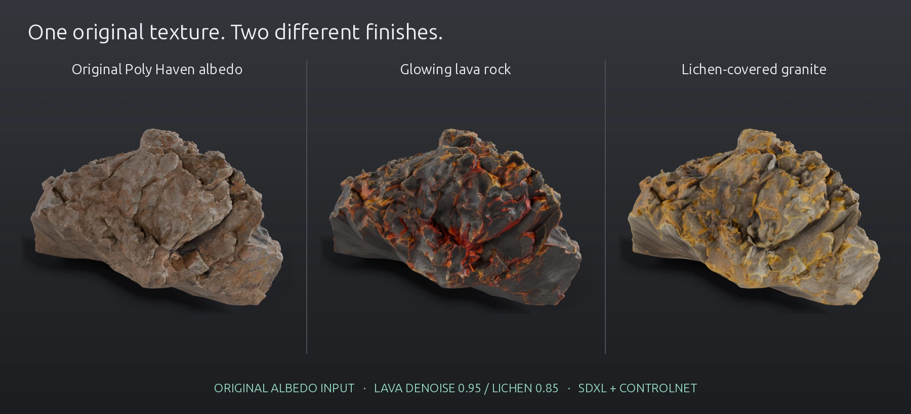
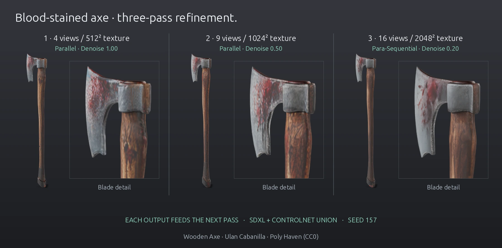
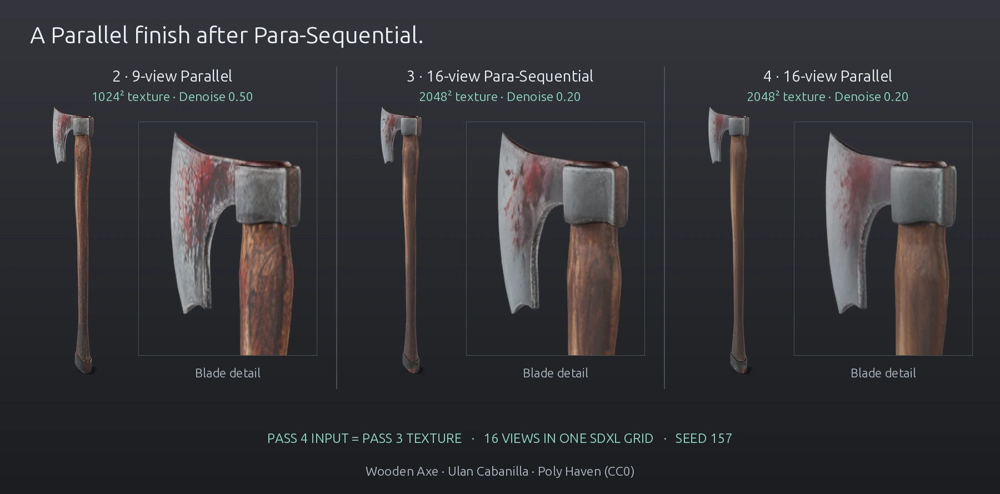
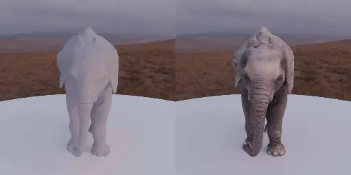
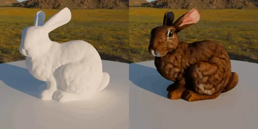
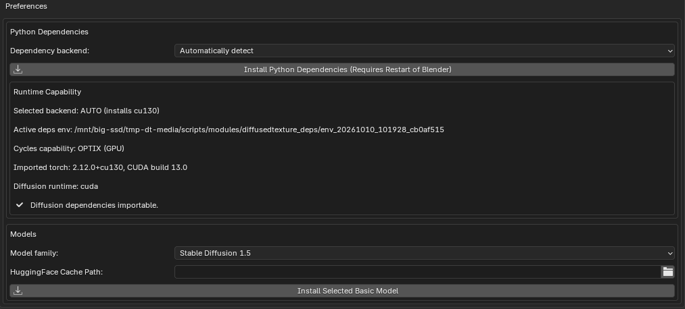

# DiffusedTexture: AI Texture Generator for Blender

DiffusedTexture is a free, open-source Blender add-on that generates textures directly on your 3D mesh with **Stable Diffusion 1.5** or **SDXL**. Depth, canny and normal **ControlNets** keep the result aligned with the geometry, and the generated views are projected and baked into your UV map. Everything runs locally on your own GPU: no cloud service and no subscription. It supports text-to-texture, image-to-texture refinement, **LoRA** and **IP-Adapter**.

SDXL textures on detailed CC0 models from [Poly Haven](https://polyhaven.com/models), rendered in Cycles. The carved mane, ornate chest fittings and fractured boulder provide geometry for Depth, Canny and Normal ControlNet guidance. The boulder refines its original albedo; the lion and chest start untextured. [Camera sweep (MP4)](images/showcase.mp4).

Models: [Lion Head](https://polyhaven.com/a/lion_head) by [Tina](https://polyhaven.com/all?a=Tina); [Treasure Chest](https://polyhaven.com/a/treasure_chest) by [Rico Cilliers](https://polyhaven.com/all?a=Rico+Cilliers); [Boulder 01](https://polyhaven.com/a/boulder_01) by [Rico Cilliers](https://polyhaven.com/all?a=Rico+Cilliers). All three source assets are [CC0](https://polyhaven.com/license).

Models, prompts and settings used for these images

One generation pass per model: **SDXL**, **Parallel** mode, **High** mesh complexity, **4 camera views**, texture resolution **2048**, render resolution **4096**, Custom SD Resolution **768**, **40 steps**, guidance **7.5**. The chest starts untextured with **denoise 1.0**, **ControlNet Union strength 0.9** and **seed 61**. The lion also starts untextured, with **denoise 1.0**, **ControlNet Union strength 0.45** and **seed 91** to allow more ornamental surface detail. The boulder uses its **original albedo as Input Texture**, **denoise 0.95**, **ControlNet Union strength 0.35** and **seed 181**.

| CC0 model | Triangles used | Prompt |
| --- | ---: | --- |
| [Lion Head](https://polyhaven.com/a/lion_head) | 47,214 | Damascene lion head, dense intricate gold and silver floral inlay covering dark bronze, high contrast arabesque engraving across the face and mane, tiny etched leaves and curling vines, hand-chiseled stippling, aged hammered metal with dark oxidized recesses, richly decorated antique Persian metalwork, photorealistic surface texture |
| [Treasure Chest](https://polyhaven.com/a/treasure_chest) | 103,330 | an antique pirate treasure chest, weathered dark walnut wooden planks, aged turquoise painted wood with flaking paint revealing warm timber, tarnished brass bands hinges and lock, photorealistic material, detailed surface |
| [Boulder 01](https://polyhaven.com/a/boulder_01) | 66,122 | (glowing molten lava rock:1.4), volcanic boulder made of jagged black basalt plates, wide branching rivers of (brilliant yellow white hot magma:1.5) flowing through deep cracks, vivid golden orange molten veins and red hot fissures across the entire surface, dark porous cooled lava crust with tiny bubbles and granular mineral texture, dramatic bright incandescent cracks contrasting with charcoal black stone, photorealistic detailed volcanic rock |

The chest's five parts are joined without changing their shared UV atlas. The lion retains its original geometry and UV map. The boulder uses only the highest-detail **LOD0**, preserving its original UV map. It has one closed component, no boundary or non-manifold edges, and no overlapping texels in a 1024-pixel UV raster check. The lower-detail LOD meshes are excluded.

Negative prompt: *blurry, low quality, deformed, text, watermark, logo, cartoon, painting, harsh shadows, strong highlights, lens flare, oversaturated*

The lion also excludes: *smooth featureless surface, plain unadorned metal, plastic, green marble, black monochrome*.

The lava boulder uses this negative prompt: *blurry, low quality, deformed, text, watermark, logo, cartoon, harsh shadows, lens flare, plastic, smooth surface, polished stone, featureless, flat color, vegetation, flames, smoke*.

The actual four-view guidance grids used for the boulder hero:

Source download URLs, checksums and settings are recorded in [the media recipe](documentation/media_recipe.json).

Recorded in Blender 5.2 with SD 1.5 on an RTX 3080 Ti. The generation step is shortened (about 2.5 minutes in reality). [Full-quality MP4](images/usage.mp4). Model: [Marble Bust 01](https://polyhaven.com/a/marble_bust_01) by [Rico Cilliers](https://polyhaven.com/all?a=Rico+Cilliers), CC0.

## Features

- **Text-to-texture and image-to-texture**: describe a texture with a prompt, or refine an existing texture with a lower denoise strength.
- **Geometry-aware generation**: Depth, Canny and Normal ControlNets (SD 1.5) or ControlNet Union (SDXL) follow the shape of your mesh.
- **Multi-view projection**: renders 4, 9 or 16 camera views and blends them into one UV texture of up to 4096×4096.
- **Three operation modes**: Parallel, Sequential and Para-Sequential (see [Usage](#how-to-texture-a-model-with-ai-in-blender)).
- **Style control**: stack several LoRA models, or use an image as a style reference with IP-Adapter.
- **Custom checkpoints**: use any compatible SD 1.5 or SDXL model from Hugging Face or a local `.safetensors` file.
- **Background generation**: after the guidance renders (which briefly freeze Blender), diffusion runs in the background and can be cancelled.

## How it works

Blender renders the mesh from several cameras. Each view provides a color render of the current texture plus depth, canny and normal guidance. In **Parallel** mode, SDXL with ControlNet generates all views together as one image grid, which keeps them consistent. Each generated pixel is projected back onto the UV map, with views that face the surface directly weighted most. Every panel above is the actual image passed to or returned from the pipeline for the lava boulder at the top of this page. The canny edges are derived from the normal render. See [documentation/DOCUMENTATION.md](documentation/DOCUMENTATION.md) for the full pipeline.

## Texture-to-texture: vary an existing material

Both variations start independently from [Boulder 01](https://polyhaven.com/a/boulder_01)’s **original downloaded albedo** by [Rico Cilliers](https://polyhaven.com/all?a=Rico+Cilliers), selected as **Input Texture**. Each uses one pass with the shared SDXL settings above. The lava version uses **denoise 0.95**, **ControlNet Union strength 0.35** and **seed 181** for a stronger transformation. The lichen version uses **denoise 0.85**, **ControlNet Union strength 0.30** and **seed 197**. The lava version uses the prompt and negative prompt in the table. The lichen version uses:

> A lichen encrusted boulder, abundant vivid yellow green and pale mint green crustose lichen covering every face of the rock in intricate circular rosettes, scattered golden yellow and orange lichen patches, detailed tiny branching frilled lobes, cracked scaly organic crust and powdery granules, small exposed islands of dark coarse granite between dense lichen colonies, speckled quartz grains, photorealistic macro texture of an old lichen covered stone

Negative prompt: *blurry, low quality, deformed, text, watermark, logo, cartoon, harsh shadows, lens flare, plastic, smooth surface, polished stone, featureless, flat color, thick moss carpet, leaves, grass*.

All three panels use the same mesh, UVs, camera, lighting, crop and diffuse-only material settings. The input is `boulder_01_diff_2k.jpg`; source normal and roughness maps are excluded from every comparison render. The lava's bright fissures come from the generated color texture; no emission or bloom is added. Lower denoise preserves more of the original texture; higher denoise allows a stronger variation.

Axe refinement: 4 → 9 → 16 views, then a Parallel finish

This run starts with an untextured [Wooden Axe](https://polyhaven.com/a/wooden_axe) by [Ulan Cabanilla](https://polyhaven.com/all?a=Ulan+Cabanilla), CC0. Each generated UV texture becomes **Input Texture** for the next pass. All four passes use the blood-stained prompt and negative prompt below, **SDXL**, **High** mesh complexity, **40 inference steps**, **guidance 7.5**, **ControlNet Union strength 0.65** and **seed 157**.

> A blood stained wood handled axe, irregular dark crimson dried blood smears and red blood spatters covering the silver steel axe head, thick red stains along the sharp cutting edge, scratched forged steel visible beneath the stains, warm oiled wooden handle with fine grain and reddish bloody fingerprints near the head, detailed photorealistic prop surface texture

Negative prompt: *blurry, low quality, deformed, text, watermark, logo, cartoon, harsh shadows, lens flare, plastic, solid red surface, person, hand*.

| Pass | Mode | Cameras | Texture output | Guidance render per view | SDXL tile per view | Denoise |
| --- | --- | ---: | ---: | ---: | ---: | ---: |
| 1 | Parallel | 4 | 512² | 1024² | 512² | 1.00 |
| 2 | Parallel | 9 | 1024² | 2048² | 512² | 0.50 |
| 3 | Para-Sequential | 16 | 2048² | 4096² | 768² | 0.20 |
| 4 | Parallel | 16 | 2048² | 4096² | 512² | 0.20 |

The first two SDXL grids are **1024²** and **1536²**. The third pass uses four sequential **2×2 sub-grids**, each **1536²**, updating the texture between groups. The comparison uses a matched camera, lighting and diffuse-only shader across all stages, with the camera rotated 180° from the initial axe comparison to show the other blade face.

In this run, the third pass visibly softens the wood grain and small blood speckles.

The exact texture chain, checksums, captured SDXL calls and saved-scene checks are recorded in [the progressive recipe](documentation/axe_progressive_recipe.json).

The fourth pass takes the exact **pass-three texture as Input Texture**, with **16 cameras in Parallel**, **denoise 0.20** and a **2048² texture output**. It uses a single **2048² SDXL grid**, with **512² per view**, and reuses the same 4096² guidance renders. Pass three uses 768² per view, so this comparison changes both the operation mode and per-view diffusion resolution.

Pass four further softens the wood grain and merges the blood speckles into a broader stain. It does not restore the fine detail visible in pass two.

The fourth-pass input checksum, actual SDXL call and matched-scene checks are recorded in [the Parallel finish recipe](documentation/axe_parallel_finish_recipe.json).

## Examples

| Elephant | Stanford Bunny |
| :---: | :---: |
|  |  |
| Prompt: *"A photorealistic elephant"* | Prompt: *"A photorealistic rabbit"* |
| Model: [Elephant – Natural History Museum](https://www.cgtrader.com/free-3d-print-models/miniatures/other/elephant-natural-history-museum-1), uploaded by [KRONOS77](https://www.cgtrader.com/designers/kronos77) | Model: [Stanford Bunny](https://graphics.stanford.edu/data/3Dscanrep/) — Stanford University Computer Graphics Laboratory |

## Requirements

- Blender 4.2 or newer (tested through 5.2 LTS)
- Windows x64 or Linux x64 (macOS is not supported)
- An NVIDIA GPU (CUDA) is recommended. AMD GPUs work on Linux through ROCm 6.3. CPU-only works but is very slow.
- VRAM: SD 1.5 at default settings peaked at 3.7 GiB in our tests. SDXL needs about 10 GiB with **Custom SD Resolution** set to 768; at its default 1024 it runs out of memory on a 12 GB GPU.
- RAM: 16 GB is enough at default settings (8.2 GiB peak). Render resolution 4096 peaked at 14.7 GiB with SD 1.5 and 23.7 GiB with SDXL, so 32 GB is recommended there.
- Disk: about 5 GB for the Python dependencies, plus 11 GB for the SD 1.5 models or 21 GB for SDXL.
- Internet access for the one-time dependency and model download

See [Speed and memory](documentation/DOCUMENTATION.md#speed-and-memory) for measured times and VRAM at different settings.

## Installation

1. Download `diffused_texture_addon-<version>.zip` from the [latest release](https://github.com/FrederikHasecke/diffused-texture-addon/releases/latest).
2. In Blender, open `Edit > Preferences > Add-ons`, click the dropdown in the top right, choose `Install from Disk...` and select the zip.
3. Enable online access in `Edit > Preferences > System > Network > Allow Online Access`.
4. In the DiffusedTexture add-on preferences, pick a **Dependency backend** (`Automatically detect` works for most setups) and click **Install Python Dependencies**. This installs PyTorch and diffusers and takes a while.
5. **Restart Blender.** The DiffusedTexture sidebar tab only appears once the dependencies are installed.
6. (Optional) Choose a **Model family** (SD 1.5 or SDXL) and click **Install Selected Basic Model** to download the models ahead of time. You can set a custom **HuggingFace Cache Path**. If you skip this step, the models download the first time you generate.

The **Runtime Capability** box in the preferences shows the installed backend, the device Cycles will render with, and whether texture generation is ready. See [Runtime Capability](documentation/DOCUMENTATION.md#runtime-capability) for details.

## How to Texture a Model with AI in Blender

1. **UV-unwrap your mesh.** `Smart UV Project` works well. The whole mesh gets one texture, so its UV islands must not overlap, including islands that belong to different materials.
2. Open the **DiffusedTexture** tab in the 3D Viewport sidebar (press `N`) and choose the **Mesh Object** and **UV Map**.
3. Enter a **Prompt** and **Negative Prompt**. Set **Inference Steps** and **Guidance Scale**.
4. Choose your settings:
   - **Operation Mode**
     - `Parallel`: all views are generated together in one grid. Fastest and most consistent; the best choice for a new texture.
     - `Sequential`: one view at a time, each reprojected before the next. Slower, but good for refining an existing texture.
     - `Para-Sequential`: views are processed in sub-grids (set **Subgrid Rows** and **Subgrid Columns**). A trade-off between the two.
   - **Mesh Complexity**: `Low` uses depth only, `Medium` adds canny, and `High` adds normals. Higher settings follow the geometry more closely but give the model less creative freedom.
   - **Camera Views**: 4, 9 or 16. More views cover the surface better but use more VRAM.
   - **Texture Resolution** and **Render Resolution**: keep the render resolution at least 2× the texture resolution.
   - **Texture Margin**: how far island colors are extended past UV seams so they don't show as thin lines. The default works for most meshes.
   - **Output Path** (required) and **Seed**
5. *(Optional)* For image-to-texture, set an **Input Texture** and lower **Denoise Strength** below `1.0`.
6. Click **Start Texture Generation**. The texture is saved to the output path and applied to the mesh as a new material.

The **Advanced Settings**, **LoRA Models** and **IPAdapter** panels let you switch between SD 1.5 and SDXL, load a custom checkpoint, change the SD resolution and ControlNet strengths, add LoRAs, and supply a style reference image.

For how the add-on works internally, see [documentation/DOCUMENTATION.md](documentation/DOCUMENTATION.md).

## Troubleshooting

- **No DiffusedTexture tab in the sidebar**: make sure the add-on is enabled under `Edit > Preferences > Add-ons`, the Python dependencies are installed, and Blender was restarted afterwards.
- **"Online access is disabled"**: enable `Allow Online Access` under `Preferences > System > Network`.
- **Out of GPU memory**: use fewer camera views, a lower **Custom SD Resolution** (*Advanced Settings*), or SD 1.5 instead of SDXL, and close other GPU-heavy apps. On a 12 GB GPU, SDXL needs a Custom SD Resolution of 768 and as little other GPU usage as possible.
- **Wrong device or backend**: check the **Runtime Capability** box in the add-on preferences, then reinstall dependencies with a different **Dependency backend** if needed.
- **Generation fails**: the error message includes the path to `diffused_texture_addon.log`. Attach that file when you [open an issue](https://github.com/FrederikHasecke/diffused-texture-addon/issues).

## Contributing

See [CONTRIBUTING.md](CONTRIBUTING.md) for setup and commit conventions, [documentation/TESTING.md](documentation/TESTING.md) for the test workflow, and [documentation/RELEASING.md](documentation/RELEASING.md) for release automation. The README images are rebuilt with [scripts/media](scripts/media/README.md).

## License

[GPL-3.0-or-later](LICENSE)

## Acknowledgements

- Inspired by [Dream Textures](https://github.com/carson-katri/dream-textures) by [Carson Katri](https://github.com/carson-katri).
- Powered by:
  - [Stable Diffusion](https://arxiv.org/pdf/2112.10752)
  - [HuggingFace Diffusers](https://huggingface.co/docs/diffusers/index)
  - [ControlNet](https://arxiv.org/pdf/2302.05543)
  - [IPAdapter](https://arxiv.org/pdf/2308.06721)
- Influenced by research in [TEXTure](https://arxiv.org/pdf/2302.01721), [Text2Tex](https://arxiv.org/pdf/2303.11396), [Paint3D](https://arxiv.org/pdf/2312.13913), [MatAtlas](https://arxiv.org/pdf/2404.02899) and [EucliDreamer](https://arxiv.org/pdf/2404.10279).
