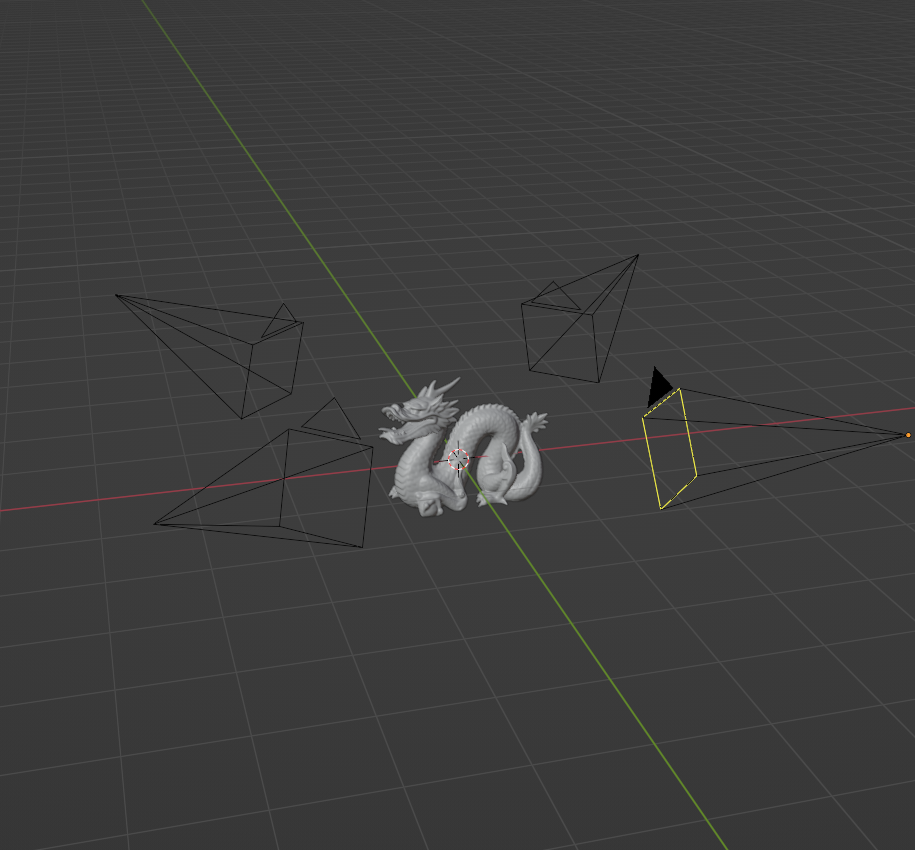
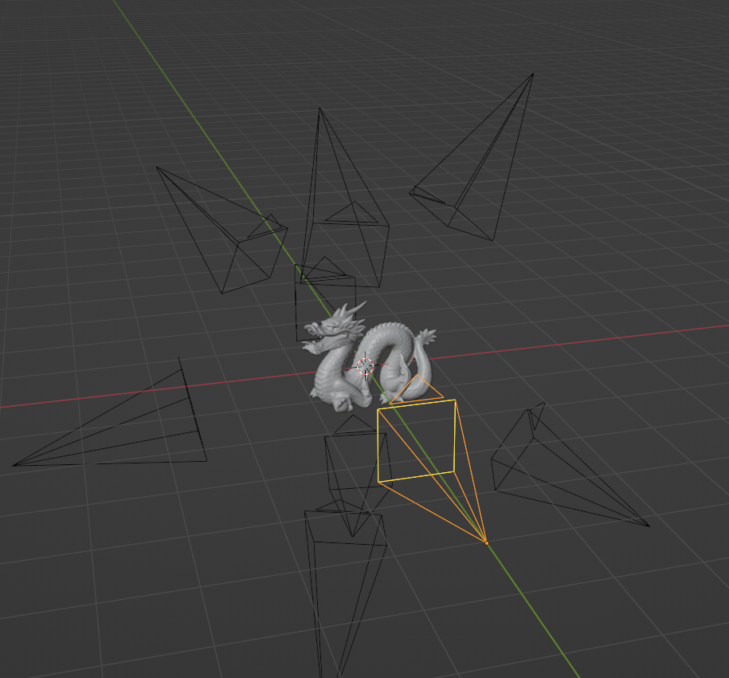
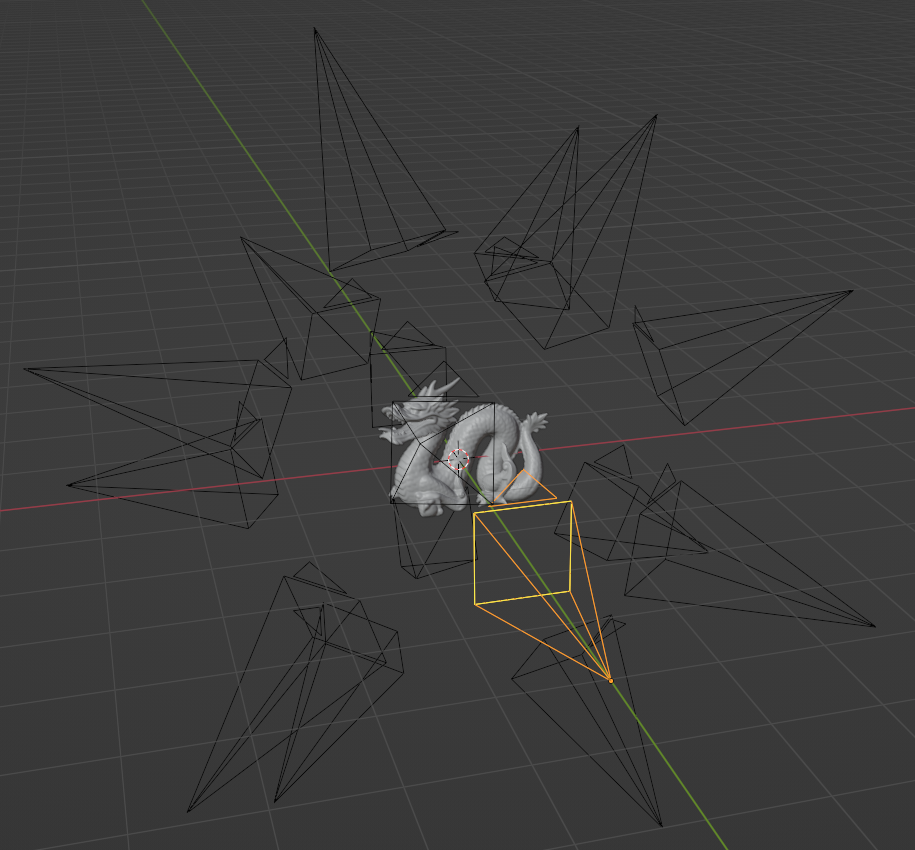

# How DiffusedTexture Works

## Overview

DiffusedTexture renders your mesh from several cameras, turns those renders into ControlNet guidance images, lets Stable Diffusion paint the views, and projects the result back into the mesh's UV texture. The **Operation Mode** decides how the views are processed: all together (`Parallel`), one at a time (`Sequential`), or in groups (`Para-Sequential`).

The result is a single texture for the whole mesh, applied through one new material on every material slot. The mesh therefore needs one UV map whose islands don't overlap. Assets that give each material its own full 0–1 UV layout (common for game-ready models) must be re-unwrapped first.

Text-to-texture and image-to-texture use the same pipeline. Without an **Input Texture**, the views start from a blank white image and **Denoise Strength** should stay at `1.0`. With an input texture, a lower denoise strength keeps more of the original.

## Models

| Model key | Base checkpoint | Guidance | Default SD resolution | IP-Adapter |
| --- | --- | --- | --- | --- |
| `sd15` | `runwayml/stable-diffusion-v1-5` | Separate depth, canny and normal ControlNets (`lllyasviel/sd-controlnet-*`) | 512 | Yes |
| `sdxl` | `stabilityai/stable-diffusion-xl-base-1.0` | One ControlNet Union model (`xinsir/controlnet-union-sdxl-1.0`) | 1024 | Yes |

Flux and Qwen-Image entries exist in `model_support.py` but are disabled; selecting them fails immediately with a clear error.

You can replace the base checkpoint with any compatible model in *Advanced Settings → Checkpoint*: a Hugging Face repo id, or a local `.safetensors` / `.ckpt` file.

### Download sizes

Measured with a fresh Hugging Face cache. **Install Selected Basic Model** downloads the base model, all ControlNets for that family, and the IP-Adapter with its image encoder. Weights are downloaded in full precision and converted to float16 when loaded.

| Download | Size on disk |
| --- | --- |
| Python dependencies (PyTorch with CUDA 13.0, diffusers, …) | 5.1 GB |
| SD 1.5 stack (base, depth/canny/normal ControlNets, IP-Adapter) | 11.2 GB |
| SDXL stack (base, ControlNet Union, IP-Adapter) | 21.1 GB |

### Speed and memory

Measured on an RTX 3080 Ti (12 GB) with 64 GB of system RAM, Blender 5.2, PyTorch 2.12 and CUDA 13.0, with models already downloaded. Time covers the whole run: guidance renders, UV bake, diffusion and projection. VRAM and RAM are the peaks of the Blender process, including the Cycles render passes.

| Model | Views | Mesh complexity | Texture / render resolution | SD resolution per view | Steps | Time | Peak VRAM | Peak RAM |
| --- | --- | --- | --- | --- | --- | --- | --- | --- |
| SD 1.5 (add-on defaults) | 4 | Low | 1024 / 2048 | 512 | 50 | 52 s | 3.7 GiB | 8.2 GiB |
| SD 1.5 | 4 | High | 2048 / 4096 | 512 | 40 | 2.4 min | 5.1 GiB | 14.7 GiB |
| SD 1.5 | 9 | Medium | 1024 / 2048 | 512 | 40 | 1.6 min | 5.4 GiB | 11.1 GiB |
| SDXL | 4 | High | 2048 / 4096 | 768 (custom) | 40 | 2.8 min | 9.6 GiB | 23.7 GiB |
| SDXL (default SD resolution) | 4 | any | any | 1024 | any | out of GPU memory on 12 GB | — | — |

- **SDXL on 12 GB:** at the default 1024 per view, 4 views make a 2048×2048 grid, and the UNet runs out of memory during denoising. Set **Custom SD Resolution** to 768. That needs about 9.6 GiB, so close other GPU-heavy apps; even a second Blender window can tip it over.
- **RAM grows with the render resolution and the number of views**, because every view's guidance passes are loaded at full render resolution. Prefer 2048 renders with 9 or 16 views, or plan for 32 GB of RAM or more.

## Runtime Capability

- Dependency installation and runtime execution are separate decisions.
- The **Dependency backend** in the add-on preferences controls which PyTorch wheels are installed for diffusion: auto-detect, CPU, CUDA 12.6 / 12.8 / 12.9 / 13.0+, or ROCm 6.3 (Linux, AMD).
- The **runtime capability** is decided at generation time from:
  - the Cycles device Blender can configure for the render pass, and
  - the device PyTorch can use for diffusion.
- For Cycles, the add-on prefers `OPTIX`, `CUDA`, `HIP`, `ONEAPI` and `METAL`, then falls back to `CPU`. A machine can therefore run diffusion on the GPU and still render the guidance passes on the CPU, or the other way round.
- The **Runtime Capability** box in the add-on preferences shows the current result.

---

## Cameras

**Camera Views** sets how many viewpoints are rendered. More views cover more of the surface, but cost more time and VRAM.

### 4 cameras
Minimal coverage and fast. Good for simple models or a first pass you refine later.

### 9 cameras
Balanced detail and coverage. Suitable for most models.

### 16 cameras
Maximum coverage for detailed models, especially in a second or third pass over an already textured object. May run out of memory on smaller GPUs.

---

## Operation Modes

### Parallel

All camera views are generated in a single diffusion pass.

1. **Grid layout**: the views are tiled into one image grid (2×2, 3×3 or 4×4). Each view is rendered at the SD resolution, so a 3×3 grid with SDXL is a 3072×3072 image.
2. **Input**: the grid starts from the input texture as seen by each camera, or from a white image for text-to-texture.
3. **Guidance**: depth, canny (computed from the normal renders) and normal images are tiled in the same grid layout and fed to the ControlNets.
4. **Projection**: each view's pixels are projected back into UV space, weighted by how directly the surface faces that camera, so the views blend smoothly.

Because the model sees every view at once, Parallel gives the most globally consistent result. It is the default and the best choice for a new texture.

### Sequential

Views are generated one at a time.

1. **One view per pass**: each camera view is processed on its own.
2. **Masking**: only surfaces that face the current camera closely enough are repainted.
3. **Reprojection**: after each view, the result is projected into the texture, so the next view starts from the updated texture.

Sequential is slower and can show seams between views, but it lets each view refine the texture in turn. Use it to refine an existing texture rather than to create one.

### Para-Sequential

A hybrid of the two. Views are split into sub-grids of **Subgrid Rows** × **Subgrid Columns**. Each sub-grid is generated in parallel, and the sub-grids run one after another, each reprojected before the next. For example, 16 cameras with a 2×2 sub-grid run as four passes of four views each. The smaller grids need much less memory than one large Parallel grid, while each pass still keeps several views consistent with each other.

### UV seam stitching and padding

After any mode finishes, a stitching pass evens out color jumps across UV seams. Then the colors at the edge of each UV island are extended outward by the **Texture Margin** (16 px at 2048, scaled for other resolutions), so texture filtering doesn't pull the background into the seams.

---

## Parameters

### Resolutions
- **Texture Resolution**: size of the final texture (512 to 4096).
- **Render Resolution**: size of the guidance renders. Keep it at least 2× the texture resolution to avoid striping artifacts.
- **Custom SD Resolution** (*Advanced Settings*): overrides the per-view resolution Stable Diffusion works at (default 512 for SD 1.5, 1024 for SDXL). The full grid is this value times the grid size, so higher values and more cameras quickly run out of memory.

### Mesh Complexity (ControlNets)
- `Low`: depth only. Most creative, least precise.
- `Medium`: depth and canny. Balanced.
- `High`: depth, canny and normal. Most precise, least creative.

With SD 1.5 each guidance type has its own ControlNet and strength. With SDXL all of them go through one ControlNet Union model with a single strength.

### Style control
- **LoRA Models**: add one or more LoRA files, each with its own strength.
- **IPAdapter**: give an image as a style or content reference instead of, or in addition to, the prompt.
